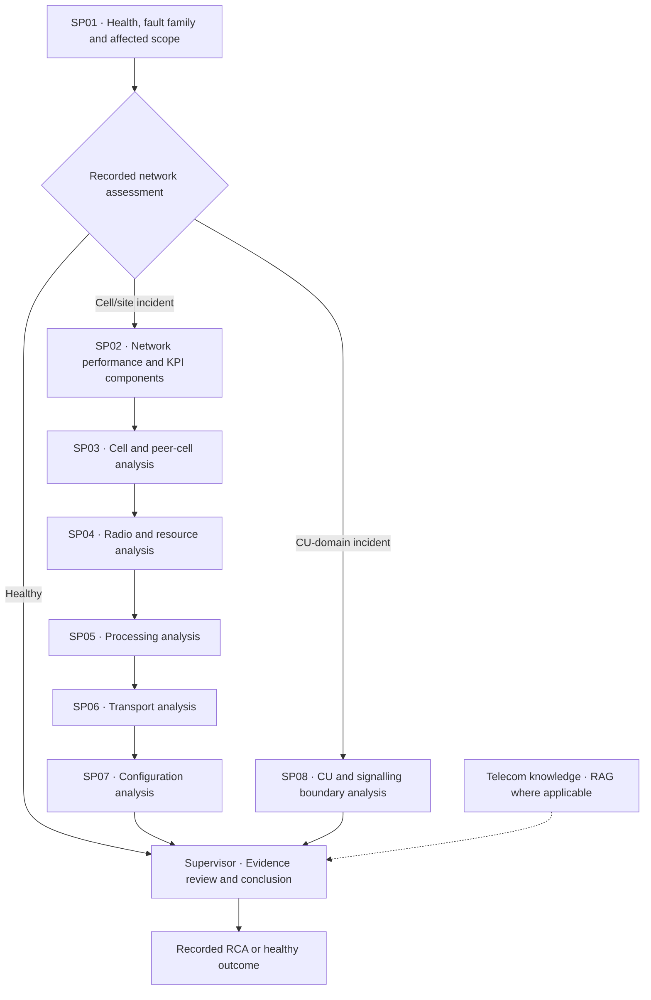

# TEAD AI — Agentic Telecom Network Investigation & Root Cause Analysis

**An evidence-grounded, multi-agent 5G network investigation prototype.** Explore nine recorded synthetic-network investigations, conditional specialist workflows, and inspectable root-cause conclusions in a read-only Streamlit demonstration.

[**Open the live demonstration**](https://tead-ai.streamlit.app/) · [**Explore the scenarios and evidence**](https://tead-ai.streamlit.app/) · [**Professional project evidence**](docs/portfolio/CV_EVIDENCE_BRIEF.md)

> **Current public UI: V1.7.5 RC2.2 (16 October 2026).** This is a recorded experimental demonstration, **not** live network telemetry, a production deployment, or autonomous network remediation. The independent **85.3% (4.265/5)** evaluation belongs to **RC2.1**, the preceding build, and must not be interpreted as an independent RC2.2 score. Facilitated demonstrations were approved within the verified desktop scope; unconditional formal V1 closeout was not approved.

## The engineering problem

Mobile-network incident investigation requires engineers to correlate network performance metrics, alarms and events, radio-resource behaviour, transport conditions, processing state, configuration and domain knowledge. A plausible AI explanation alone is not sufficient: an engineering diagnosis needs traceable observations, competing explanations, uncertainty and the ability to be reviewed.

**TEAD AI explores how machine learning and orchestrated specialist agents can support that investigation.** In the recorded development executions, an initial network assessment selected a suitable investigative route, relevant specialists examined domain evidence, and a Supervisor synthesised a qualified Root Cause Analysis (RCA). The public website *replays those completed executions*; it does not run agents, models or network tools again.

## What the prototype demonstrates

- **Machine-learning-assisted assessment:** SP01 combines fault-family and affected-scope model outputs with recorded topology, event and network performance evidence.
- **Conditional agent orchestration:** healthy networks bypass specialist escalation; cell/site incidents pass through the six sequential specialist stages SP02–SP07; Central Unit (CU) domain incidents take the alternative SP08 investigation route.
- **Evidence-grounded engineering analysis:** saved tool outputs, source references, relevant measurements, competing explanations and unresolved uncertainty remain inspectable.
- **Supervisor conclusion:** synthesises technical findings and uses curated telecom knowledge via Retrieval-Augmented Generation (RAG) where applicable, without treating retrieved material as proof of incident causality.
- **Two complementary experiences:** Guided Operations communicates the investigation as an executive or engineering journey; Agentic Replay exposes saved execution beats, stage progression, tools and recorded trace provenance.
- **Accessible terminology:** RC2.2 introduces first-use acronym explanations on all nine pages and a searchable 33-term glossary for telecom and AI concepts.

### Conditional investigation routes



The routes are **alternatives**, not parallel duplicates. For the selected cell/site cases, SP02–SP07 executed sequentially. SP08 is an alternative CU-domain route, **not** an additional stage following SP07. The healthy control proceeds to Supervisor review without specialist escalation.

## Experimental network and recorded dataset

| Item | Recorded scope |
| --- | --- |
| Network model | Synthetic fifth-generation (5G) network |
| Radio topology | 10 modelled gNodeB sites; 30 logical NR cells (three per site) |
| Centralised network context | Two CU domains and represented CU/DU/F1/E1/N2/AMF relationships |
| Performance reporting | 15-minute performance management (PM) sampling; scenario observation windows vary |
| Saved investigations | Nine cases: eight incidents and one healthy control |
| Bundled evidence | Nine compressed cases, 126 compressed evidence artifacts, and `data/manifest.json` |
| Public demonstration behaviour | Read-only playback; no live inference, telemetry access or remediation |

The manifest records scenario selection, source references and hashes. The original multi-gigabyte trace exports and restricted knowledge-base passages are **not** distributed by this repository.

## Observed experimental outcomes

These are measurements from the **previously completed synthetic-network experiments**, not Streamlit playback timings or operator service-level agreements.

| Observed activity | Measured result | Scope |
| --- | --- | --- |
| SP01 health assessment and initial localisation | **15.0–24.3 seconds** (under 25 seconds) | 9/9 recorded cases |
| Initial affected-scope localisation | Included within SP01 | 8/8 incident cases; not a separately measured two-minute milestone |
| Specialist investigation | **42.1 seconds–1 minute 51.6 seconds** | Eight incidents, using SP02–SP07 or SP08 |
| Supervisor evidence synthesis and RCA | **1 minute 38.8 seconds–2 minutes 53.4 seconds** | Eight incident cases |
| End-to-end incident investigation | **2 minutes 48.2 seconds–4 minutes 32.9 seconds** (under five minutes) | 8/8 incident cases |
| Healthy control | **17.2 seconds** end to end | One control; direct Supervisor review |

Stage-duration ranges can originate from different cases and **must not be added** to form a single incident duration. A representative CU-domain evidence-formatting experiment reduced a payload from approximately **17.29 MB to 227 KB (~98.7% smaller by byte size)**; this is **not** an independently measured reduction in billed tokens, inference cost, latency, operating expenditure, or network mean time to repair (MTTR).

## Explore the nine pages

| Workspace | What to look for |
| --- | --- |
| **Platform Overview** | Architecture, engineering approach, saved outcomes and experimental boundaries |
| **Value Proposition & Solutions** | Demonstrated opportunities, solution positioning and future research separation |
| **Guided Operations Demo** | Executive and Full Engineering step-by-step investigation presentations |
| **Network Overview** | Modelled topology, CU relationships, domain interfaces and observed network context |
| **Scenario Library** | Nine scenario identities, fault families, recorded windows and affected scopes |
| **Agentic Replay** | Saved agent/tool execution beats, inspector stages, trace timing and Supervisor handover |
| **Root Cause Analysis** | Recorded diagnosis, decisive evidence, alternative explanations and uncertainty |
| **Engineering Evidence** | Original saved measurements, dimension-aware series and source-linked telemetry |
| **Evaluation & Performance** | Recorded durations, model/judge assessments and provenance limitations |

Use the glossary in the application's sidebar to look up network and AI acronyms as you explore.

## Technical implementation

The public playback application uses Python, Streamlit, Plotly and bundled compressed JSON. Modules include `operational_demo.py`, `storyboard.py`, `guided_story_ui.py`, `network_overview.py`, `measurement_series.py`, `presentation.py`, `value_solutions.py`, `terminology.py` and `release_identity.py`.

The underlying experiments used machine-learning tools and LangGraph-orchestrated agents, with recorded LangSmith execution traces. **These services are not called by the deployed Streamlit interface.** `build_replay.py` is a historical evidence-package builder: it requires external source trace exports and source notebook/audit files that are **not included** in the public repository, and is not needed to run the shipped demo.

## Local execution and validation

Python 3.11+ is supported for the public playback package.

```powershell
python -m venv .venv
.\.venv\Scripts\Activate.ps1
python -m pip install -r requirements.txt
streamlit run app.py
```

Run regression tests with UTF-8 fixture decoding:

```powershell
python -m pip install pytest
python -X utf8 -m pytest -q tests
```

The app reads `data/` and requires **no inference API keys or production network credentials**. Local automated tests do not substitute for live browser or mobile responsive acceptance.

## Independent assessment and boundaries

An independent review of **V1.7.5 RC2.1** scored the experimental platform **4.265/5 (85.3%)**, an improvement over the preceding RC1 assessment of **4.085/5 (81.7%)**. The assessment covered 18/18 Guided Operations journeys, representative Agentic Replay routes, targeted Restart operations, measurement-chart integrity and desktop navigation. Those completed acceptance observations are attributable to **RC2.1**; RC2.2 is a separate terminology-focused update.

The assessor supported **facilitated demonstrations within tested desktop conditions**, but did **not** grant unconditional formal V1 closeout. The remaining acceptance decisions included broader evidence-identity verification, the exhaustive playback state matrix, exact viewport coverage, a deployed-build-to-commit link, and independent evaluation reproducibility or an explicit scoped deferral.

Important limitations:

- The public platform is an **offline replay** of synthetic-network experiments, not a live network assurance or autonomous closed-loop system.
- Saved classifier, judge and exact-match outputs are **research artifacts**, not independently established production diagnostic accuracy. The complete judge rubric and field-level comparison records were unavailable for independent recomputation.
- No operator-validated reductions in MTTR, OPEX, production tokens, inference cost or network recovery time are claimed.
- No automatic network changes, closed-loop enforcement or physical root-cause proof are implied by the recorded diagnoses.

## Documentation and release history

- [**Current UI release notes — V1.7.5 RC2.2 (UX-01)**](docs/releases/V1_7_5_RC2_2_UX01_RELEASE_NOTES.md)
- [Previous independent-test candidate — RC2.1 notes](docs/releases/V1_7_5_RC2_1_RELEASE_NOTES.md)
- [Historic release notes index](docs/releases/README.md)
- [Archived development README](docs/README_LEGACY_ARCHIVE.md)
- [CV and professional project evidence brief](docs/portfolio/CV_EVIDENCE_BRIEF.md)
- [Saved case and evidence manifest](data/manifest.json)

Older releases used the TREAD AI name and the former `tread-ai.streamlit.app` URL. Historical documentation is retained for traceability; the **current public demo URL is https://tead-ai.streamlit.app/**.
