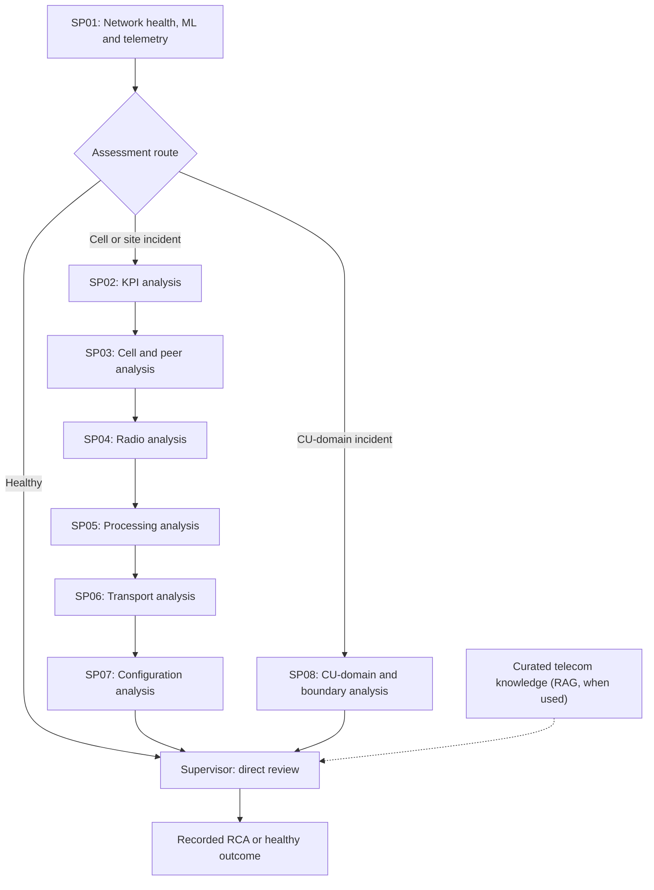

# TEAD AI — Agentic Telecom Network Investigation & Root Cause Analysis

**Evidence-grounded 5G network investigation and draft RCA in under five minutes — demonstrated across eight recorded synthetic incident cases.**

[**Explore the interactive TEAD AI demonstration**](https://tread-ai.streamlit.app/) · [**Review engineering evidence**](https://tread-ai.streamlit.app/) · [**CV evidence brief**](CV_EVIDENCE_BRIEF.md)

## Why TEAD AI exists

Telecommunications fault investigation often requires engineers to correlate performance counters, event telemetry, alarms, radio and processing behaviour, transport conditions, configuration and domain knowledge. Determining the most likely cause—and assembling a defensible RCA—can be time-consuming, especially when symptoms span network layers. Formal operator review and approval may take additional time.

**TEAD AI is an experimental agentic telecom engineering system built to make that analytical process faster, more structured and easier to verify.** It combines **two machine-learning prediction tools**, **15-minute synthetic 5G network telemetry**, **LangGraph-orchestrated specialist AI investigations** and **knowledge-grounded Supervisor reasoning** to produce an inspectable root-cause conclusion supported by network evidence, competing explanations and uncertainty qualifications.

**What we demonstrated:** Eight incident investigations completed end-to-end in **2m 48.2s–4m 32.9s**, with network health assessment and initial fault-scope localisation completed in **15.0–24.3 seconds** across all nine cases (eight incidents plus one healthy control). These are measured durations of previously completed experimental executions—not forecasts, operator MTTR reductions or production SLAs.

### Why it matters

- **Faster analytical turnaround:** Demonstrates structured multi-domain investigation and draft RCA generation within minutes in a controlled experimental setting.
- **Better engineering focus:** Uses conditional routing to bypass unnecessary specialist escalation when a healthy network is observed, and direct detected incidents toward the relevant investigation path.
- **Traceable findings:** Retains specialist observations, original tool outputs, supporting/contradictory evidence, uncertainty and source provenance for independent inspection.
- **A foundation for future autonomy:** Establishes investigation and decision-support capabilities that could be extended with live integrations, governance, human approval and controlled remediation. **Those capabilities are not claimed as deployed here.**

## Measured experimental outcomes

| Outcome | Observed result | Scope |
| --- | --- | --- |
| **Network assessment and initial localisation (SP01)** | **15.0–24.3 s** · **<25 s** | 9/9 recorded cases; both milestones share one SP01 completion timestamp |
| **Affected-scope localisation** | **8/8 incident cases** | Affected scope identified in SP01; not a separate two-minute operation |
| **Specialist investigation** | **42.1 s–1m 51.6s** | Eight incident cases; SP02–SP07 or SP08 |
| **Supervisor evidence synthesis and RCA** | **1m 38.8s–2m 53.4s** | Eight incident cases |
| **End-to-end incident investigation** | **2m 48.2s–4m 32.9s** · **<5 min** | 8/8 incident cases, including Supervisor RCA |
| **Healthy-network control** | **17.2 s end-to-end** | One separate healthy scenario; no specialist escalation |

**Interpretation:** The stage ranges above can come from different scenarios and should not be added together. Reported timing is from recorded LangSmith/LangGraph execution, **not** Streamlit playback time. Each scenario is an independent synthetic-network snapshot; cases are not one continuous incident timeline.

### Evidence preparation and inference optimisation

During related Module 5 development, a deterministic CU-domain evidence representation reduced one SP08 payload from **approximately 17.29 MB to 227 KB (~98.7% smaller)**. The optimisation targeted evidence representation size while retaining structured diagnostic information and access to the original observations. This is **not** a measured 98.7% reduction in billed model tokens, inference cost, latency or network MTTR. The reduction is a development-stage example, not a claim that every replay case achieved the same result.

Further engineering lessons included controlling large LLM input/output contexts, separating deterministic preprocessing from model reasoning, suppressing unnecessary repeat analysis, using bounded technical retries and evaluating model choices against reasoning quality, reliability, latency and cost—not parameter count alone. Historical cost/token comparisons are not presented as independently validated financial savings.

## What I designed and built

The underlying **Module 5 experimental platform** and the **public demonstration** have different roles:

- **SP01 — Network Health & Localisation:** Initiates assessment, invokes two ML prediction tools (fault family and affected scope), reviews network overview/event telemetry and identifies the supported affected domain.
- **Conditional LangGraph orchestration:** Healthy control goes to direct Supervisor review; cell/site incidents go through **SP02 → SP03 → SP04 → SP05 → SP06 → SP07 sequentially**; CU-domain cases use **SP08** as an alternative investigation route.
- **Specialist engineering evidence:** KPI/KPI-component, cell/peer, radio, processing, transport, configuration and CU/boundary analysis use structured network measurements and recorded tool evidence.
- **Supervisor synthesis:** Consolidates observations, assesses plausible and competing explanations, uses curated telecom knowledge-base RAG **where applicable**, and produces recorded evidence-grounded RCA findings and qualified uncertainty.
- **Evidence and inference engineering:** Deterministic transformation/aggregation, context-budget and cost controls, guarded failure recovery, provenance, post-run evaluation and trace attribution.
- **Executive and Full Engineering presentation:** A Streamlit cockpit replays saved investigator activity, allowing stage-by-stage exploration of agents, tool calls, telemetry, evidence and findings.

### Investigation flow



**Routing note:** The three branches represent mutually alternative recorded routes. SP02–SP07 executed sequentially in the selected cell/site traces; SP08 is not a seventh specialist after SP07. RAG is supporting reasoning rather than an independent source of proven diagnosis. The public demonstration does not run these agents live.

## Explore the demonstration

[**Open TEAD AI on Streamlit**](https://tread-ai.streamlit.app/)

The public site is an **offline recorded investigation replay**, not a live fault-monitoring or autonomous-remediation service. It presents original execution timings and inspectable saved trace evidence without requiring new LLM inference or telecom-network access.

| Platform page | What to explore |
| --- | --- |
| **Platform Overview** | Purpose, single-frame conditional architecture, measured execution performance and key engineering learnings |
| **Guided Operations Demo** | Executive (~90-second presentation) or Full Engineering walkthrough in the unified investigation cockpit |
| **Network Overview** | Recorded network topology, observations and selected-scenario context |
| **Scenario Library** | Nine synthetic cases, fault families, scopes and outcomes |
| **Agentic Replay** | Source-backed saved orchestration stages, specialist calls and Supervisor handovers |
| **Root Cause Analysis** | Recorded conclusion, evidence, competing hypotheses, uncertainty and knowledge-base contribution |
| **Engineering Evidence** | Original 15-minute KPI series, specialist tool outputs and evidence identifiers |
| **Evaluation & Performance** | Trace durations, stage timing, provenance and saved post-run quality checks |

### Engineering credibility and limitations

- **Nine selected synthetic cases:** Eight incidents plus one healthy control; selected traces and 126 frozen evidence artifacts underpin the public replay. Original trace hashes and scenario provenance are recorded in [`data/manifest.json`](data/manifest.json).
- **No live execution in the web demo:** No active LangGraph reasoning, model calls, RAG retrieval, telecom telemetry polling or remediation is performed by the deployed Streamlit interface.
- **Qualification of model and judge outputs:** ML predictions are supporting, uncalibrated evidence. Saved judge and exact-match evaluations are post-run assessments, not independent proof of real-network root-cause accuracy.
- **Production claims are deliberately limited:** Human-versus-AI investigation-time studies, operator-approved RCA turnaround, production MTTR savings, cost reductions and autonomous closed-loop performance **have not been demonstrated**.
- **Knowledge and data protection:** Public extracts exclude restricted raw knowledge passages and do not ship credentials, model weights or the multi-gigabyte original LangSmith trace exports.

## Run locally and validate

Python **3.11+** is supported for the public replay package. From the repository root:

```powershell
python -m venv .venv
.\.venv\Scripts\Activate.ps1
python -m pip install -r requirements.txt
streamlit run app.py
```

For the offline test suite on Windows, explicitly enable UTF-8 decoding of the saved JSON test fixtures:

```powershell
python -X utf8 -m pytest -q tests
```

The app uses saved files from `data/` and requires no production credentials or inference API keys. A passing unit-test suite does not replace independent **live-browser acceptance** of the deployed application or its responsive layout.

## Project documentation and release history

For implementation, data provenance and older validation rationale, see the following materials:

- [**Current release notes — V1.6.3**](V1_6_3_RELEASE_NOTES.md): corrected SP01 <25-second presentation and first-page positioning.
- [V1.6.2 release notes](V1_6_2_RELEASE_NOTES.md): compact single-frame architecture and preserved detailed diagram.
- [V1.6.1 release notes](V1_6_1_RELEASE_NOTES.md): connected conditional investigation flow.
- [V1.6.0 release notes](V1_6_0_RELEASE_NOTES.md): performance ranges and engineering learnings.
- [V1.5.0 release notes](V1_5_0_RELEASE_NOTES.md): unified replay cockpit.
- [V1.4.3 release notes](V1_4_3_RELEASE_NOTES.md): replay state persistence and local test scope.
- [**Previous full README (historical archive)**](docs/README_LEGACY_ARCHIVE.md): preserved earlier release-by-release explanations, implementation details and historical instructions.
- [CV evidence brief](CV_EVIDENCE_BRIEF.md): carefully qualified project outcomes for professional use.

**Current application line:** TEAD AI V1.6.3, recorded experimental demonstration. Earlier releases used the TREAD AI name; those historical references are retained for traceability. The public site may retain its existing `tread-ai.streamlit.app` address.
